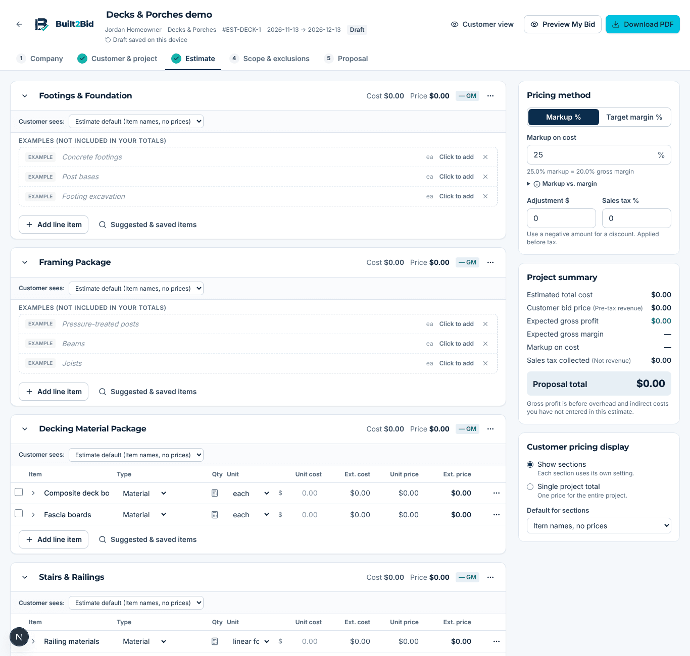
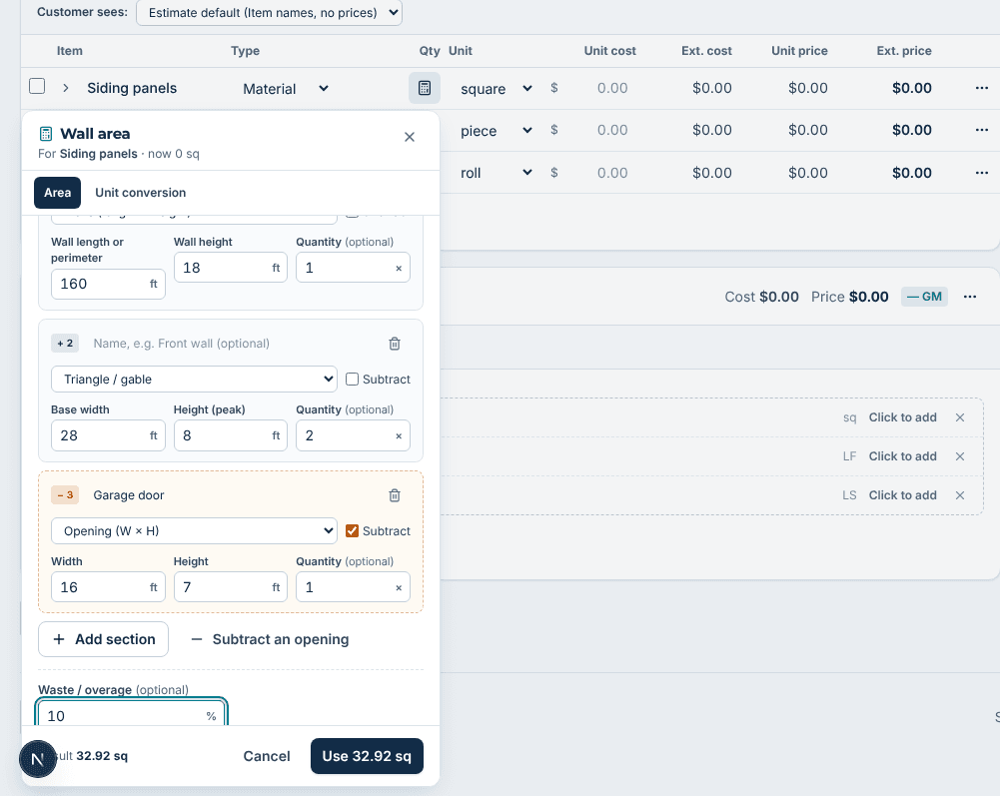
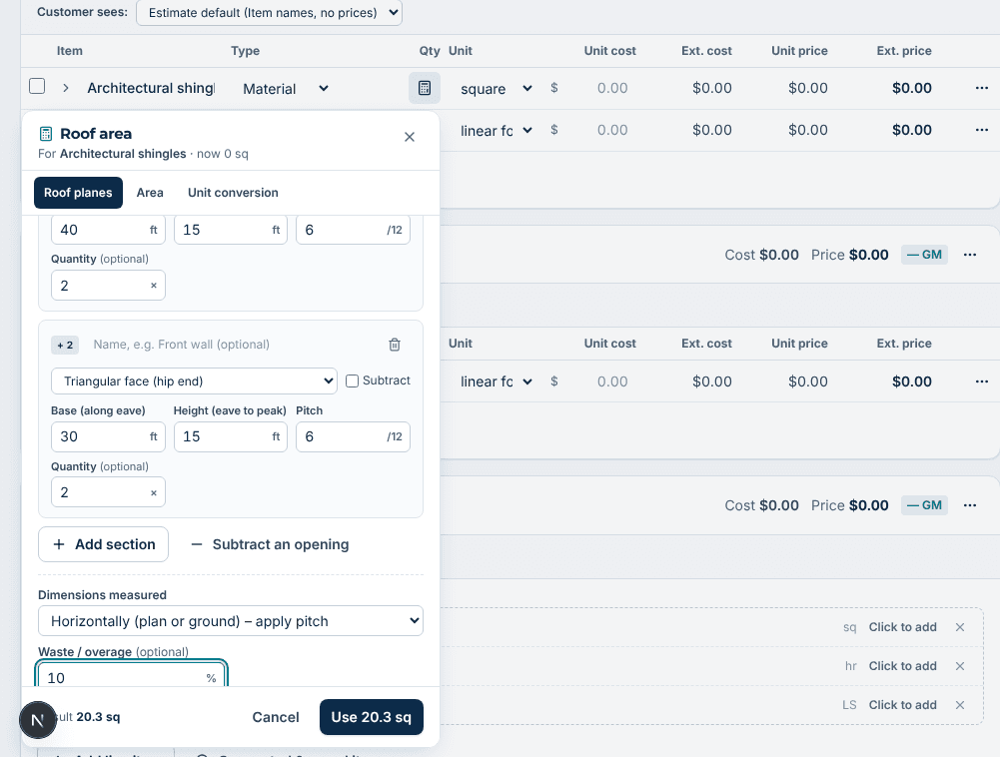
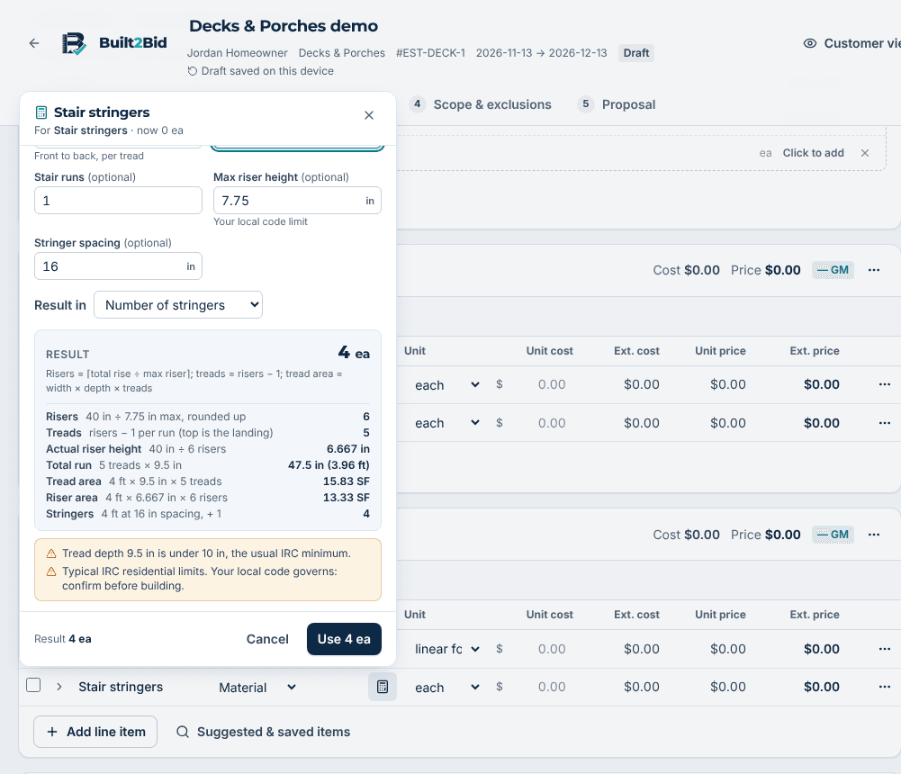
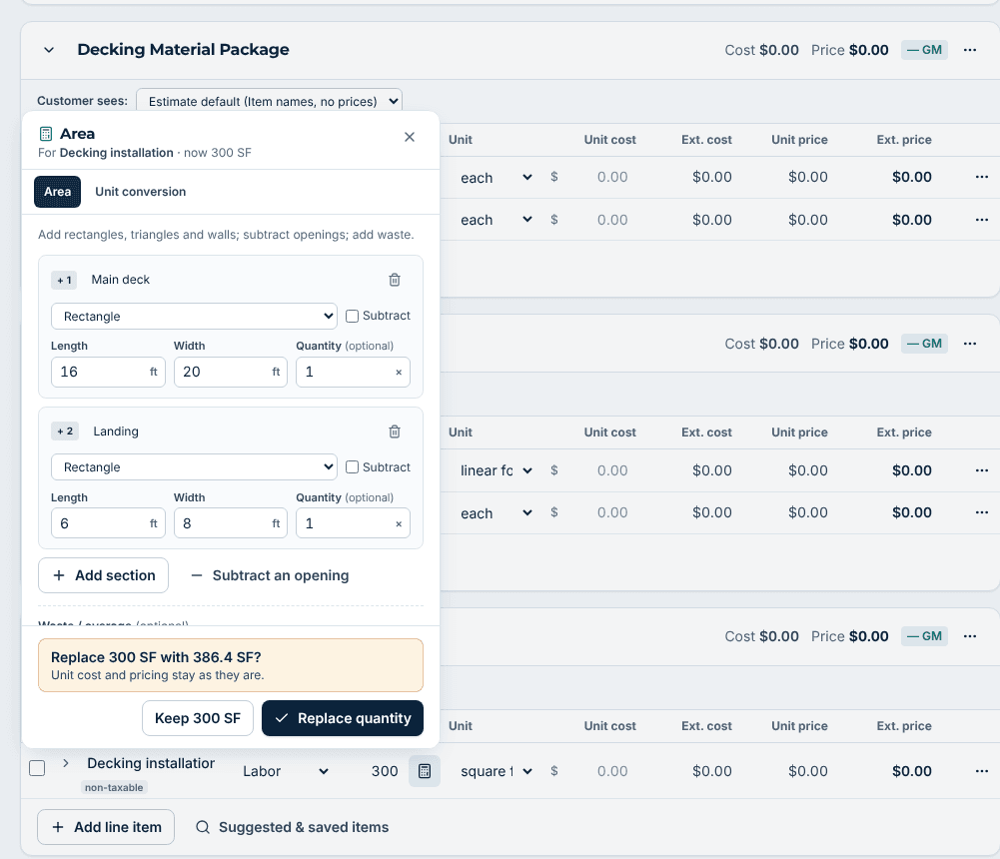
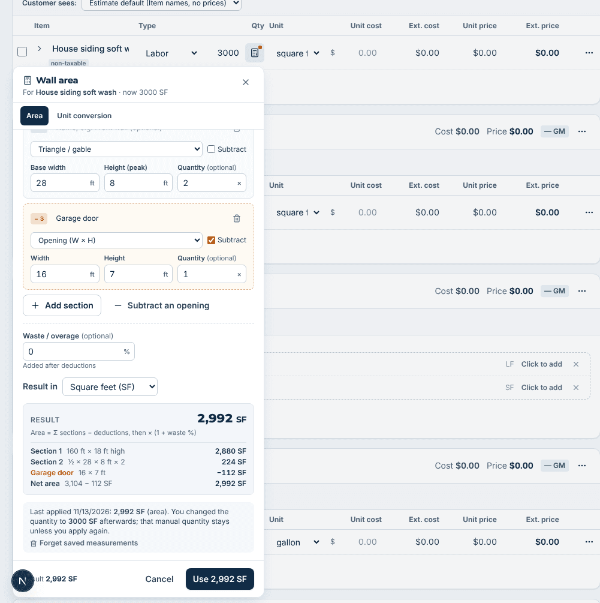
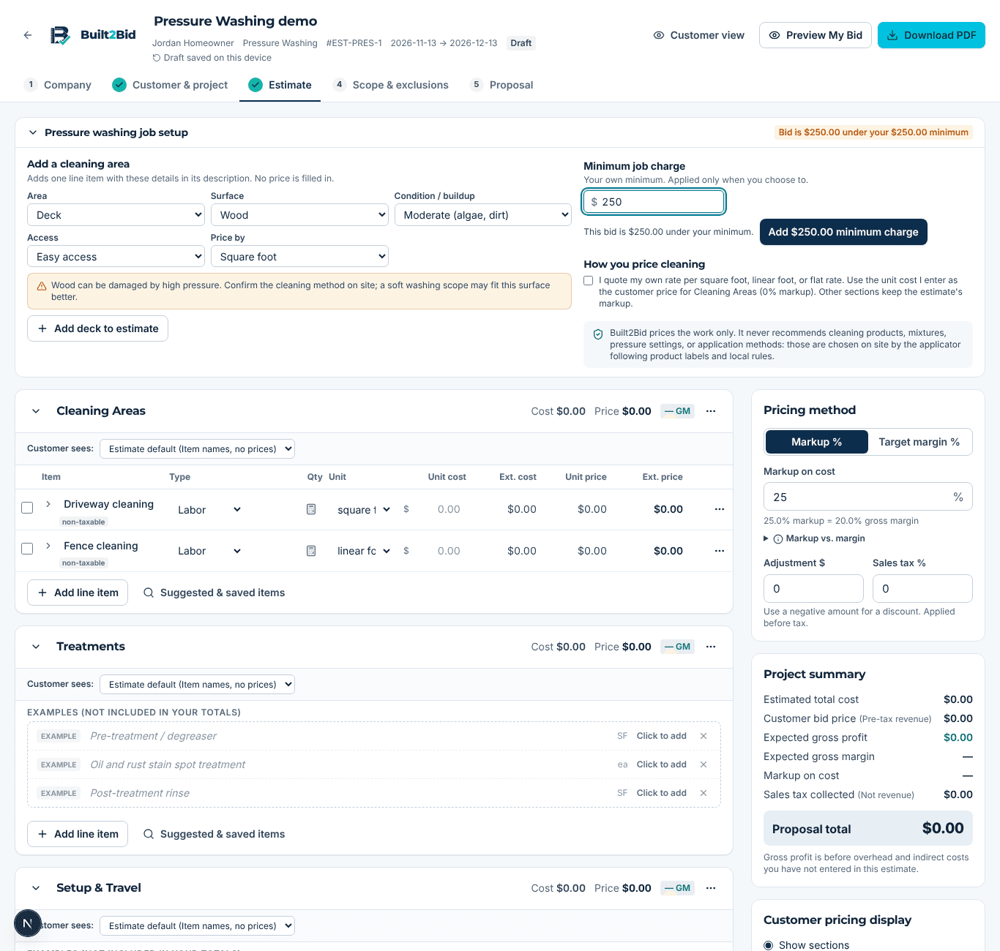
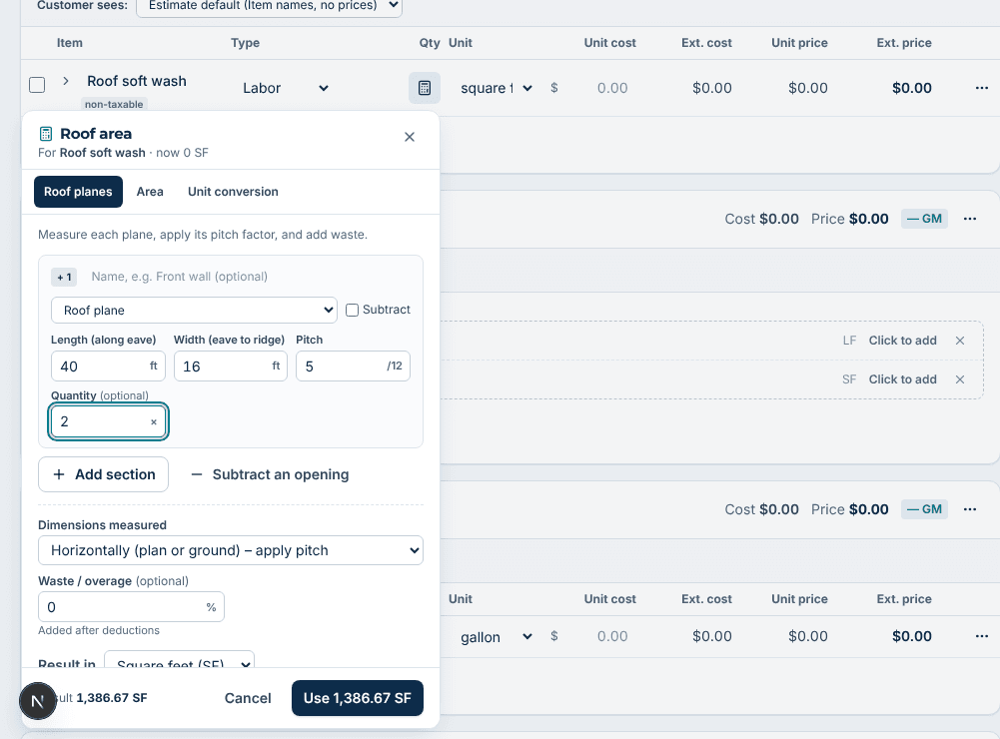
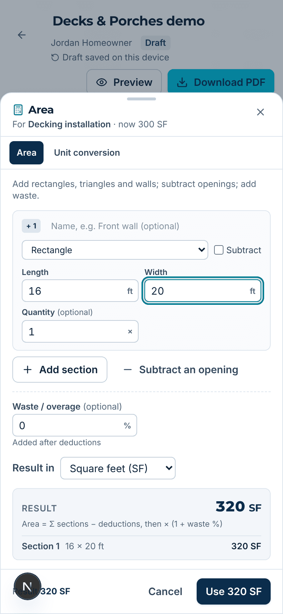
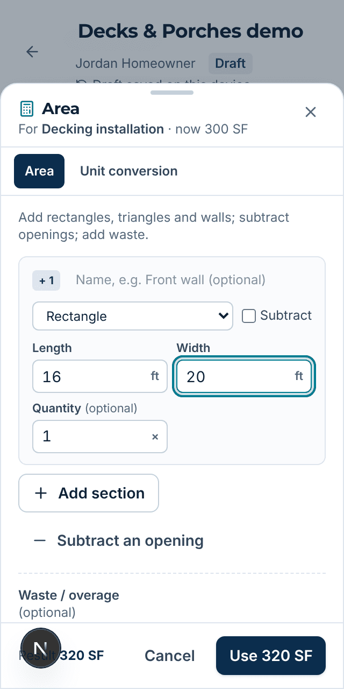

# Quantity calculators and washing trades

This change adds optional quantity calculators to every line item that can use one, plus two new trades: **Pressure Washing** and **Soft Washing**. It builds on the existing estimate engine, design system, save path, proposal and PDF. Pricing formulas, credits and billing are untouched, and **no database migration is required**.

## 1. Architecture

| Layer | File(s) | What it does |
|---|---|---|
| Parsing | `src/lib/calculators/parse.ts` | Validates each entry (empty, negative, invalid, too large). Feet fields accept `12' 6"` / `12ft 6in`. |
| Formulas | `src/lib/calculators/formulas.ts` | Pure Decimal math (area, triangle, circle, perimeter, pitch factor, volume, stairs, coverage, decking, labor, unit conversion) plus rounding. Nothing rounds silently. |
| Registry | `src/lib/calculators/registry.ts` | 10 calculators and 16 shapes. Each one returns a result with the formula, each step, the exact value, the rounded value, warnings and errors. |
| Mapping | `src/lib/calculators/mapping.ts` | Picks calculators by the item's **unit** first, then its name and trade. A calculator that can't produce the item's unit is never offered. Hour, day, lump sum, ton and load items get the labor calculator or nothing. |
| UI | `src/components/builder/calculators/quantity-calculator.tsx` | A small icon beside the Qty field opens a popover on desktop or a bottom sheet under 640px. It stays collapsed until opened. |
| Washing | `src/components/builder/calculators/washing-job-panel.tsx` | A job setup panel shown only on washing estimates (add a surface, minimum charge, rate mode, safety note). |
| State | `src/components/builder/state.ts` | Reducer actions `applyCalculation`, `clearCalculation` and `setMinimumCharge`. Apply changes only the target item's quantity and unit. |
| Persistence | `mappers.ts`, `server.ts`, `save/route.ts` | Calculator inputs are saved as `worksheet` inside the existing `proposal_config` jsonb column. Inputs for deleted items are pruned, and duplicating an estimate carries them over. |
| Versioning | `src/lib/export/snapshot.ts` | `worksheet` is excluded from the version hash, so reopening a calculator never marks a finalized bid as changed. Only an applied quantity change does. |

**Apply rules.** A result is applied only when the contractor presses Apply. If the item already has a different quantity, they must confirm before it is replaced. A unit change is called out first, and a finalized bid gets a notice. The previous quantity is kept, so "Restore previous" undoes the change. If the quantity is later edited by hand, the calculator shows an amber dot and keeps the hand-entered value. Calculators are never required.

## 2. Calculators by trade

| Trade / item type | Calculator offered | Notes |
|---|---|---|
| Decks: decking boards | Decking boards (area ÷ (face width + gap), then boards or LF) | Board length and face width are required, with no assumed sizes |
| Decks/stairs: treads, risers, stringers | Stairs | Risers = ⌈rise ÷ max riser⌉. IRC 7¾" / 10" warnings, with a reminder to check local code |
| Decks/fence: railing, fence | Linear footage (LF, pieces or each) | |
| Siding, painting, insulation, drywall, house wrap | Wall area: walls + gable triangles − openings | Outputs SF, SY or squares, plus a waste % |
| Siding: J-channel, casing, trim | Trim around openings (3- or 4-sided) | |
| Fascia, soffit, gutter, starter, baseboard | Perimeter | Each-unit trim boards divide by board length |
| Roofing: shingles, underlayment, tear-off | Roof planes / hip faces with pitch | Plan or measured surface. Warns above 24/12 |
| Roofing: ridge, hip, valley, eave, rake | Linear footage | |
| Concrete: slab, footing, pier, excavation | Volume in CY, with an allowance % | |
| Kitchens/baths: countertop, backsplash, shower walls, floor tile | Area (walls with opening deductions for showers) | |
| Paint, tile setting material, packaged goods | Coating/material coverage | Coverage per unit is required. Nothing is assumed |
| Hourly or daily labor | Labor hours from a production rate | |
| Any SF, LF or CY item | Unit conversion (extra) | Includes metric |
| Pressure washing | Area / wall area / linear (per surface) | No prices, pressures or chemicals |
| Soft washing | Wall area, roof planes | Roof work is flagged for an on-site method and safety decision |

Lump-sum, ton and load items get no calculator, so nothing irrelevant is shown.

## 3. Pressure Washing and Soft Washing

- Both are full trades in the trade picker (Exterior family) with groups, example items, FAQs, tips and a market model (surface, condition, access, stories, water on site, roof included).
- **No default prices.** Every item starts unpriced. The contractor chooses per-SF, per-LF or a flat price.
- **Job setup panel** (collapsed): add a surface with its type, condition and access (plus stories for soft washing) and a pricing basis. Also covers the minimum job charge (applied as the existing fixed adjustment, only when no other adjustment exists) and rate mode (0% markup on cleaning groups when the contractor enters final rates).
- **Safety:** the app never recommends chemicals, mixes, pressures or methods. Delicate surfaces and roof cleaning show a note that the method and safety are decided on site. The proposal adds clarifications for the cleaning method and roof method, plus exclusions for water access, stain results, existing damage and property protection. The AI proposal prompts carry the same rules.

## 4. Screenshots

All screenshots are in [`screenshots/`](screenshots/). A selection:

| | |
|---|---|
|  Collapsed by default |  Walls + gables − openings |
|  Roof planes with pitch |  Stairs with code warnings |
|  Confirm before replacing |  Manual quantity kept |
|  Pressure washing setup |  Soft washing roof |
|  390px bottom sheet |  320px bottom sheet |

## 5. Test results

**Formula and calculator unit tests** (`tests/calculators.test.ts`, 53 tests, all passing): parsing (empty, zero, negative, commas, ft-in, too large), every formula, multi-section sums and deductions, deductions larger than the total, rounding (whole units round up, others round up to 2 dp), waste, conversions in every dimension (with cross-dimension rejection), large values, required-field errors, mapping per trade, and confirming that fresh inputs never assume dimensions or prices.

**Integration and regression tests** (`tests/calculator-integration.test.tsx`, 21 tests, all passing):

- apply, edit and recalculate
- restore previous, and that example or missing items are ignored
- duplicate prevention (applying twice never adds items)
- save/reload round trip through the mappers, with pruning of deleted items
- schema bounds
- version hash unchanged by calculator inputs
- every trade gets only calculators that match its units
- washing trades: no prices, rule-based exclusions and clarifications
- an end-to-end proposal PDF for both washing trades

**Full suite:** 233 passed, 82 skipped (the database tests need a local Postgres and were not run here). `tsc` is clean, `eslint` reports 0 errors, and `npm run build` passes.

**Browser run** (Playwright against a local build, at 1440px desktop, 390px and 320px): opened calculators for each trade; applied results; confirmed a replacement; reloaded and saw both the quantity and the saved inputs; edited a quantity by hand (3000 kept, amber dot shown); covered washing setup, minimum charge, scope step and PDF. The calculator dialog and washing panel fit at 320px and 390px with no horizontal scroll inside them.

## 6. Limitations

- Dimensions are entered in feet and inches. Metric is available only through the unit conversion calculator.
- No ton or load calculators (aggregate by weight).
- At 390px the builder page itself is wider than the screen (about 814px). This already happens on `main` and is being fixed in the separate UX polish work.
- The washing trades are not marked "featured" on the trade picker.
- The condition and access chosen in the washing setup are written into the item description, not stored as separate fields.
- Admin `trade_templates` rows for the new trades are created the first time an admin publishes them. Until then the built-in seed data is used, which works.
- Tested against a local build. Saving to the live Supabase project has not been exercised; it goes through the same `save_estimate` RPC and the existing `proposal_config` column.
- Calculations are estimates for quoting. They do not replace field measurement or code review.
