# Before / after

Every route and builder state at three widths is linked in [SCREENSHOT-MANIFEST.md](SCREENSHOT-MANIFEST.md). Highlights:

| Page | Before | After | What changed |
|---|---|---|---|
| Homepage | 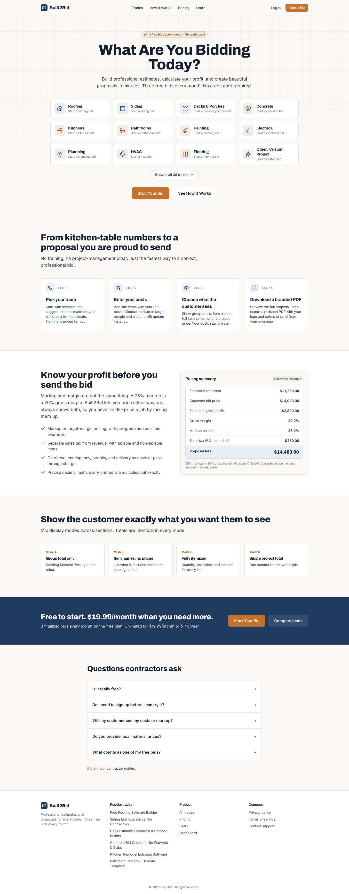 | 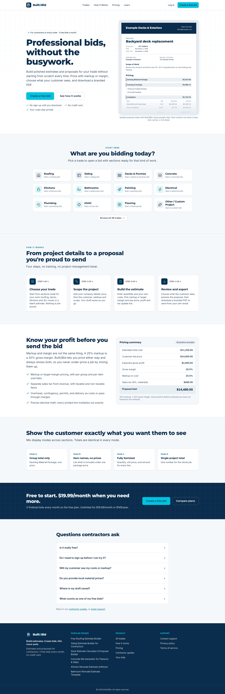 | New H1 "Professional bids, without the busywork.", brief CTAs ("Create a free bid" → trade selection, "See how it works"), real proposal renderer with labelled example data in the hero, trade picker in its own section, 4-step "How it works", navy pricing band and footer, blueprint grid motif, one more FAQ (where drafts are saved). (F2–F4, F17) |
| Homepage, mobile | 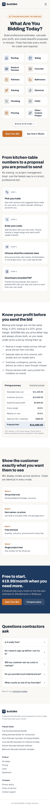 | 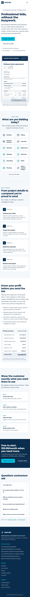 | Same, single column; no horizontal scroll. |
| Builder header, mobile | 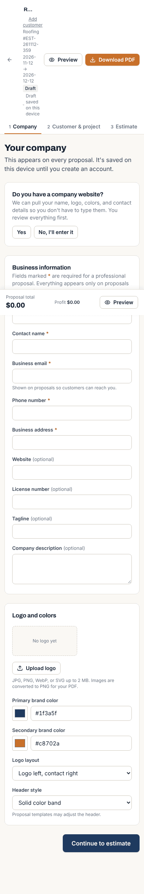 | 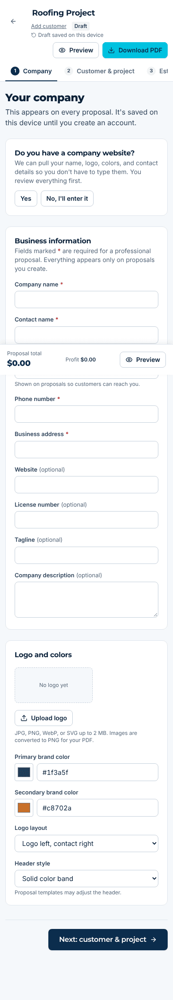 | Header shrank from ~300 px to ~180 px: title is readable, secondary meta hidden below `sm`, actions get their own row. (F5) |
| Builder: Estimate | 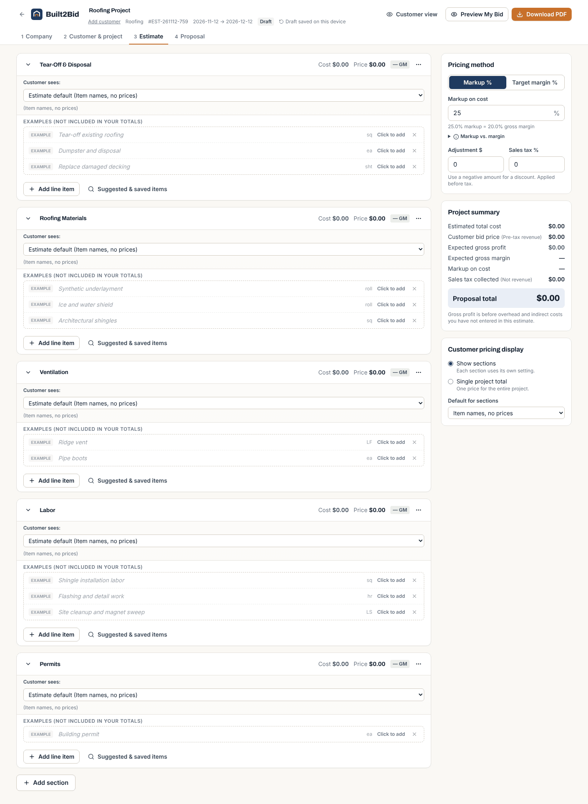 | 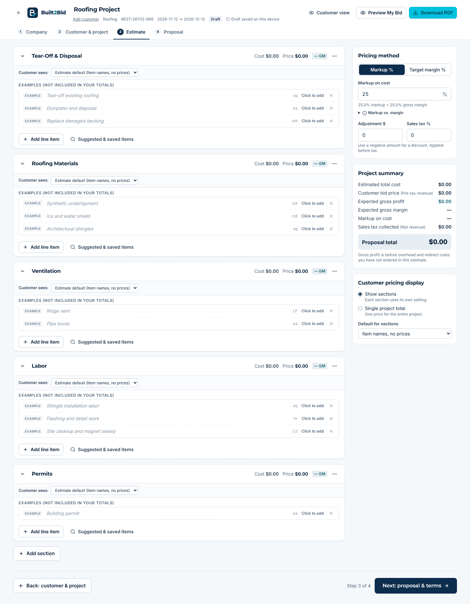 | Step tabs show completion checks and "Step X of 4" for screen readers; compact "Customer sees" control (it was stretched full width by a CSS layering bug); Back / Next footer. (F6, F8, F9) |
| Builder: Proposal | 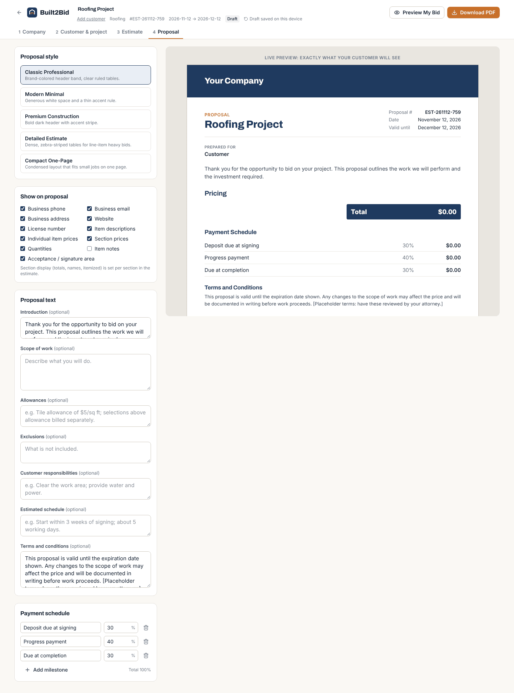 | 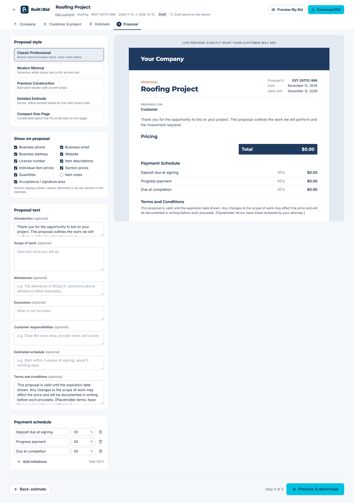 | "Preview & download" closes the flow; cool neutral preview backdrop. Contractor's own proposal branding is untouched. |
| Pricing | 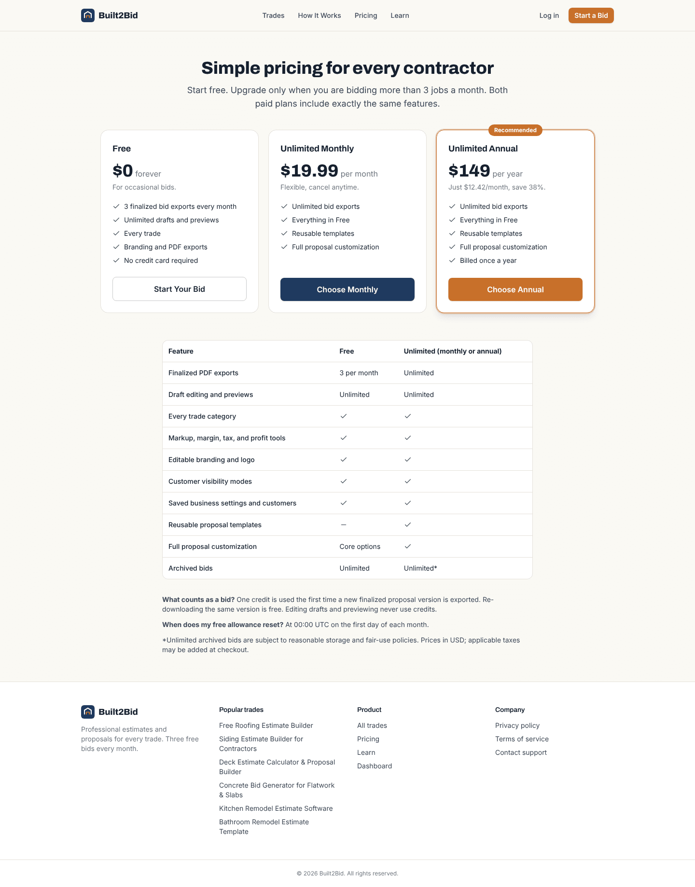 | 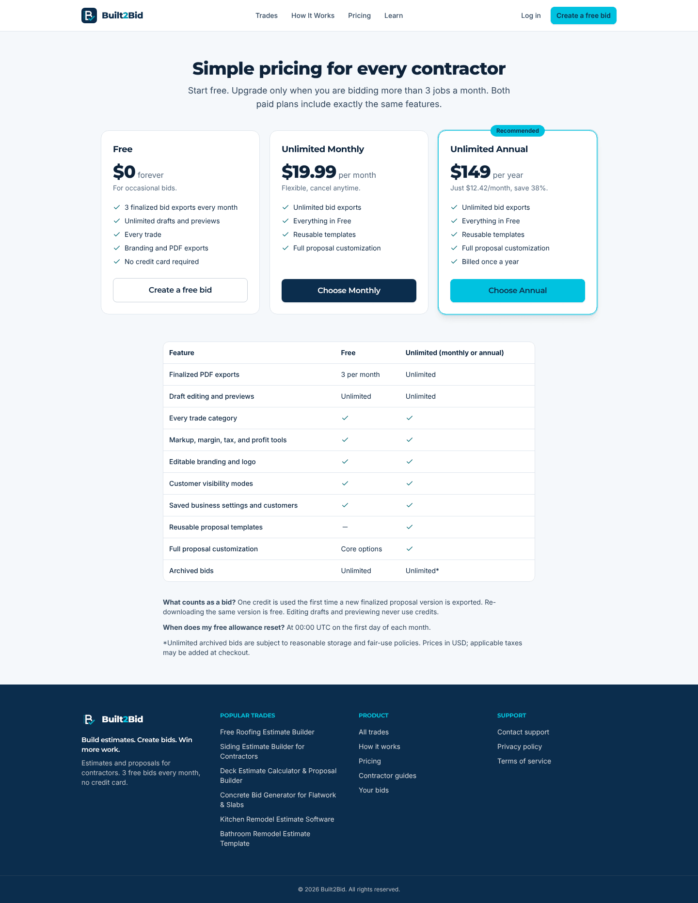 | Brand tokens; cyan "Recommended" plan with navy labels. Prices and limits unchanged. |
| Trades | 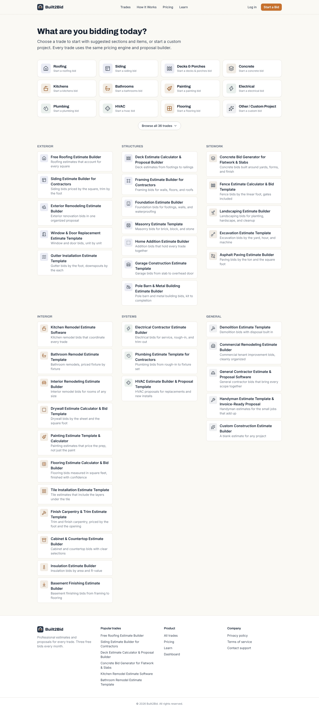 | 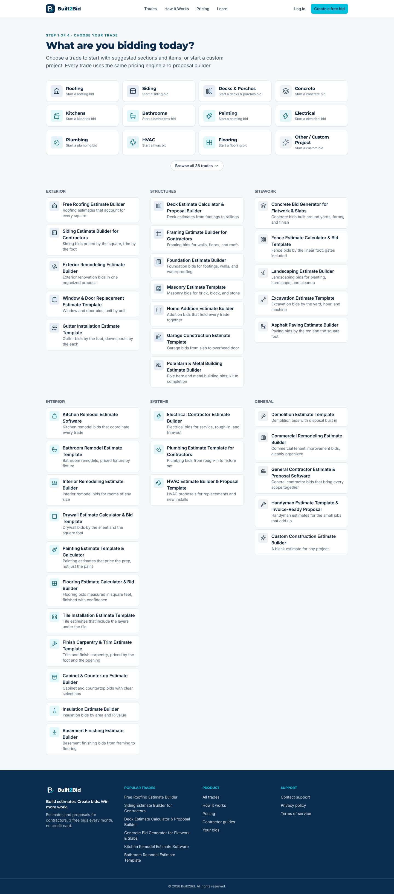 | "Step 1 of 4 · Choose your trade" eyebrow ties the homepage CTA into the builder flow; brand-family icon tints. |

**Not shown (BLOCKED):** dashboard, settings and admin need a signed-in Supabase session. Their code changed (navy sidebar with active page, 40 px row actions, status filter semantics, cyan CTA); verify visually on the Netlify deploy preview after signing in.
